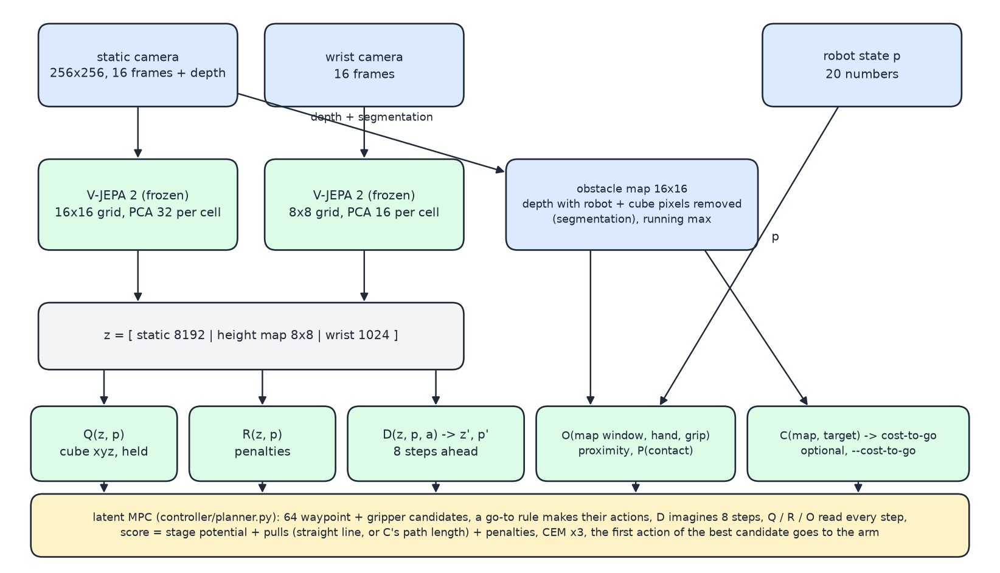
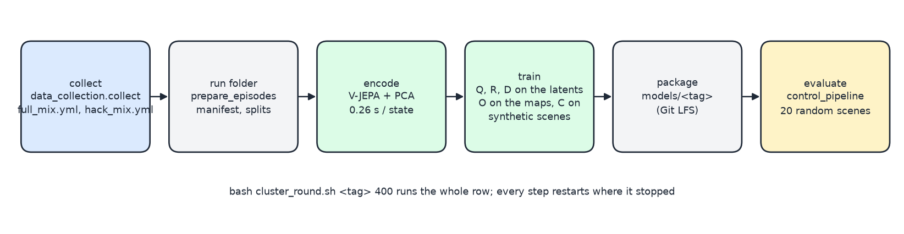

# JEPA world model for pick and place

A Franka Panda in MuJoCo picks a cube from anywhere on a table, carries it past 0-3 obstacles and puts it
down on a green marker. The controller is a model predictive controller (MPC) that plans in the latent space
of a frozen V-JEPA 2 encoder: a readout `Q` says where the cube is and whether it is held, a dynamics model
`D` imagines the latent after an action, a reward model `R` predicts the penalties, an obstacle model `O`
reads an obstacle-only depth map, and an optional cost-to-go `C` knows the way around the obstacles. No
policy is in the loop and no geometric avoidance rule. Two SAC policies are the comparison: one trained in
the simulator on the exact state (run on the exact state as `rl_true`, or on the cameras through `Q` as
`rl_q`) and one trained only in the world model's imagination (`sac_imagined`).





## What is where

Every folder has a README that says what it is for and how to run it.

```
simulation/                 the code; every command runs from here with the venv active   -> simulation/README.md
  environment/              the MuJoCo simulator: scene, obstacles, arm control, rewards, cameras  -> environment/README.md
  data_collection/          scripted and random policies that record episodes                   -> data_collection/README.md
  world_model/              run folder, V-JEPA encoding, training and checks of Q R D O C          -> world_model/README.md
  rl/                       the SAC policies and the simulator wrapper every controller runs in   -> rl/README.md
  controller/               the controllers and the two latent planners, side by side              -> controller/README.md
  configs/                  default.yml (every knob) and the override files                       -> configs/README.md
  models/                   the packaged models the controllers load (Git LFS)                    -> models/README.md
  data/                     run folders, controller episodes (local except the training data)     -> data/README.md
results/                    the controllers' summaries, and the status of the comparison           -> results/README.md
diagrams/                   the two figures above and the script that draws them
presentation/               the slides' notes, the inspection notebook and the clip catalogue
STATUS.txt                  the day-by-day log: what was measured and why each change was made
NEXT.md                     what could be done next, with the commands
setup_mujoco_headless.sh    OSMesa rendering for a machine without EGL (the course cluster's notebooks)
```

## Install

```bash
git lfs install                                                            # once per machine
GIT_LFS_SKIP_SMUDGE=1 git clone git@github.com:Sarvesh-kth/world_model_project.git   # code only
cd world_model_project
python3 -m venv .venv && source .venv/bin/activate
pip install torch==2.6.0 torchvision==0.21.0 --index-url https://download.pytorch.org/whl/cu124   # Linux + NVIDIA GPU
pip install -r requirements.txt
git lfs pull --include="simulation/models/**,simulation/data/rl_baseline_v1/**" --exclude=""      # 55 MB: run the controllers
git lfs pull --include="simulation/data/episodes_v3/**,simulation/data/episodes_hack/**" --exclude=""   # 3.3 GB: only to retrain
cd simulation
```

The encoder and the camera controllers need Linux with an NVIDIA GPU (8 GB is enough); the V-JEPA weights
(1.2 GB) download from Hugging Face on the first run. The training data comes as `latents.npy.part00/01`
and `episodes_raw.tar`; `cluster_round.sh` assembles them, or by hand:

```bash
cat data/episodes_v3/features/latents.npy.part* > data/episodes_v3/features/latents.npy
tar xf data/episodes_hack/episodes_raw.tar -C data/episodes_hack
```

Rendering: collectors, encoder and controllers render offscreen through EGL (`offscreen.py` sets it up). On
a machine without EGL export `MUJOCO_GL=osmesa PYOPENGL_PLATFORM=osmesa`. The viewer (`play.py`, the
controllers' live window) needs a display and GLX; do not export `MUJOCO_GL=egl` in a shell you start it from.

## Run

One command runs any controller; `--methods` picks which, everything else is the same:

```bash
python play.py success --seed 34                                                    # watch the scripted policy in a window
python -m controller.control_pipeline --methods mpc --random-ends --test-episodes 5 --headless --out data/try_mpc
python -m controller.control_pipeline --methods rl_q --random-ends --obstacles 0 3 --test-episodes 5 --headless --out data/try_sac
python -m controller.control_pipeline --methods scripted rl_true rl_q jepa_mpc mpc --random-ends --obstacles 0 2 --test-episodes 20 --headless --out data/compare
```

| method | perception | action |
|---|---|---|
| `scripted` | exact state | the scripted policy, the simulator's upper bound |
| `rl_true` | exact state | the simulator-trained SAC (`models/sac_priv_v1`) |
| `rl_q` | cameras through `Q` | the same SAC on the estimate |
| `mpc` | cameras through `Q`, `D`, `R`, `O` | CEM over raw action sequences imagined by `D` (`controller/mpc.py`) |
| `jepa_mpc` | cameras through `Q`, `D`, `R`, `O` (and `C`) | CEM over waypoints, a go-to rule makes the actions (`controller/planner.py`) |
| `sac_imagined` | cameras through `Q` | a SAC trained in imagination (`--imagined-run`) |

Always `--random-ends` (cube and goal anywhere on the table, the distribution the models were trained on);
`--obstacles LOW HIGH` draws that many obstacles per scene. Summaries land in `results/<out>/summary.txt`,
frames, gifs and a per-step csv in `data/<out>/episodes/<method>/seed_*/`. The comparison of the three
controllers on 0 / 1 / 2 / 3 obstacles is one script per controller, same seeds for all:

```bash
bash sac_priv_eval.sh mpc 10
bash sac_priv_eval.sh rl_q 10
bash sac_priv_eval.sh rl_true 10
python sac_priv_table.py
```

## Train

```bash
bash cluster_round.sh v3 400                             # collect 400 episodes -> encode -> Q R D O C -> models/v3 -> checks -> closed-loop runs
python -m rl.rl_baseline --out data/sac_priv_v2 --random-ends --obstacles 0 3 --obstacle-map both \
  --recorded-run data/episodes_v3 --cube-noise 0.01 --net 256 256 --demos 500 --rl-steps 300000 \
  --eval-every 20000 --validation-episodes 30 --validation-empty 10      # the simulator SAC, CPU, about 1.5 h
```

Step by step in `world_model/README.md` and `rl/README.md`.

## Results

On the same fresh scenes with 0-3 obstacles the MPC places 26/40 with zero obstacle contacts; the SAC places
27/40 on the exact state (91 contact steps) and 14/40 through the cameras. Why, and the earlier tables, in
[results/README.md](results/README.md).
